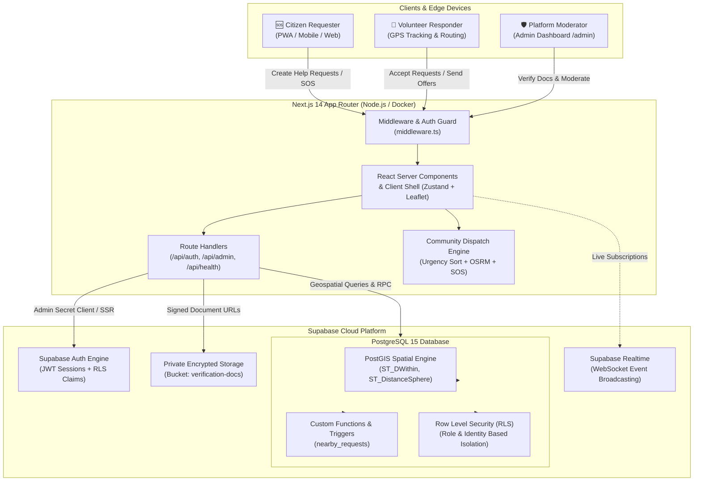

<p align="center">
  
</p>

<p align="center">
  <strong>Hyperlocal Mutual Aid & Urgent Community Crisis Response Platform</strong><br />
  <em>Powered by Three-Key Urgency Dispatch, OpenStreetMap OSRM Routing & Verified Community Trust</em>
</p>

<p align="center">
  <a href="https://github.com/krishkumarcodes/KindLink/releases/tag/v3.0.0"></a>
  <a href="https://kindlink-gd8e.onrender.com"></a>
  <a href="https://nextjs.org"></a>
  <a href="https://www.typescriptlang.org"></a>
  <a href="https://supabase.com"></a>
  <a href="https://postgis.net"></a>
  <a href="https://tailwindcss.com"></a>
  <a href="#-three-key-community-urgency-ranking"></a>
  <a href="https://docker.com"></a>
  <a href="LICENSE"></a>
</p>

---

## 📌 Table of Contents

- [🌟 Project Overview](#-project-overview)
- [⚡ Three-Key Community Urgency Ranking](#-three-key-community-urgency-ranking)
  - [1. Urgency Level, Road Distance & Waiting Time](#1-urgency-level-road-distance--waiting-time)
  - [2. OSRM Road Distance & Travel Mode Calculations](#2-osrm-road-distance--travel-mode-calculations)
  - [3. Emergency SOS Broadcast & Healthcare Facilities](#3-emergency-sos-broadcast--healthcare-facilities)
- [🔑 Showcase Demo Accounts & Credentials](#-showcase-demo-accounts--credentials)
- [🛠️ Database Setup & Demo Accounts Provisioning](#️-database-setup--demo-accounts-provisioning)
- [🏗️ Architecture & System Flow](#️-architecture--system-flow)
- [🌐 Multilingual System (29 Verified Languages)](#-multilingual-system-29-verified-languages)
- [🚀 Quickstart Guide](#-quickstart-guide)
  - [Local Development](#local-development)
  - [Cloud Deployment on Render (Docker)](#cloud-deployment-on-render-docker)
- [📁 Project Structure](#-project-structure)
- [📡 API Routes Reference](#-api-routes-reference)
- [🎓 Project Origins & Academic Attribution](#-project-origins--academic-attribution)
- [📄 License](#-license)

---

## 🌟 Project Overview

**KindLink** is an open-source, hyperlocal peer-to-peer mutual aid and emergency coordination platform designed to bridge the critical first-response gap in local neighborhoods.

Conceived and engineered for the industrial and mining belt spanning **Asansol, Burnpur, Durgapur, Dhanbad**, and surrounding regions (West Bengal & Jharkhand border), KindLink transforms neighborhood goodwill into an equitable, real-time crisis dispatch mechanism.

### Key Community Missions:
- 🩸 **Emergency Blood Donation & Platelets**: Rapid-response volunteer mobilization for critical transfusions.
- 🩺 **Medical Equipment & Wheelchairs**: Community sharing of oxygen concentrators, nebulizers, walkers, and wheelchairs.
- 👵 **Elderly Care & Life-Saving Medicine Delivery**: Proximity-matched assistance for senior citizens needing daily essentials and prescriptions.
- 📚 **Textbooks & Educational Resources**: Peer exchange of curriculum study materials (WBBSE, CBSE, ICSE, Engineering).
- 🚑 **Emergency Patient Transport**: Rapid community vehicular assistance when conventional ambulance services face delays.

### Core Distinctions:
- **Instant Access with Zero Bureaucracy**: Eliminates friction with streamlined onboarding, local fallback resilience, and non-blocking authentication.
- **Three-Key Urgency Prioritization**: Replaces arbitrary chronological feeds with a transparent three-key sort: Urgency Level (`critical` > `high` > `medium` > `low`), Nearest Distance, and Longest Waiting Time.
- **Interactive GPS Radar**: Full-screen, responsive OpenStreetMap & Leaflet geospatial radar with live distance indicators and turn-by-turn routing previews.
- **Emergency SOS Beacon**: 2-second hold-to-activate emergency trigger with pulsing tactile feedback and instant multi-channel broadcast.

---

## ⚡ Three-Key Community Urgency Ranking

KindLink prioritizes community help requests using an honest, deterministic three-key sorting model:

### 1. Urgency Level, Road Distance & Waiting Time

In crisis response, every minute matters. KindLink ranks all active requests in the database view and community feed through three successive keys:

1. **Primary Key: Urgency Level**
   - **Critical** (Rank 1): Emergency blood donations, life-critical patient transit, acute medical distress.
   - **High** (Rank 2): Oxygen refills, urgent prescription deliveries, specialized mobility needs.
   - **Medium** (Rank 3): General medical equipment loans, senior check-ins, household mobility support.
   - **Low** (Rank 4): Textbook exchanges, community study materials, non-urgent neighborhood lending.

2. **Secondary Key: Nearest Distance**
   - Responders living closest to the help location receive the highest priority visibility. Calculated using real road distances via OpenStreetMap OSRM routing.

3. **Tertiary Key: Longest Waiting Time**
   - Unresolved requests that have been waiting longer steadily rise to the top of their urgency tier, ensuring no critical request is buried or forgotten.

#### SQL Implementation (`nearby_requests`):

```sql
ORDER BY
  CASE r.urgency
    WHEN 'critical' THEN 1
    WHEN 'high'     THEN 2
    WHEN 'medium'   THEN 3
    WHEN 'low'      THEN 4
    ELSE 5
  END ASC,
  distance_km ASC,
  r.created_at ASC;
```

---

### 2. OSRM Road Distance & Travel Mode Calculations

To compute actual street routes rather than misleading straight lines, KindLink integrates the Open Source Routing Machine (OSRM) with local caching:

- 🚶 **Walking**: $5\text{ km/h}$ average urban speed
- 🚲 **Bicycle**: $15\text{ km/h}$ cycling transit speed
- 🚗 **Vehicle / Auto / Ambulance**: $30\text{ km/h}$ calibrated for municipal traffic corridors

```text
Estimated Time of Arrival (ETA) = (Road Distance in km / Mode Speed in km/h) * 60 minutes
```

Helpers see realistic travel times and route polylines on a mini-map before committing to assist.

---

### 3. Emergency SOS Broadcast & Healthcare Facilities

To protect vulnerable citizens and lone volunteers, KindLink provides:

1. **2-Second Hold-to-Activate SOS Button**:
   - Integrated on the home screen and global header with tactile inset pulsing rings and safety countdown.
   - Instantly notifies nearby verified responders with audio alerts and route guidance.

2. **Healthcare Facility Radar**:
   - Queries OpenStreetMap Overpass API for nearest hospitals, clinics, pharmacies, and certified blood banks.
   - Curated emergency contact directory for Asansol Sub-Divisional Hospital, Burnpur SAIL Hospital, and Durgapur Health World with one-tap calling and navigation directions.

---

## 🔑 Showcase Demo Accounts & Credentials

For academic grading, portfolio evaluations, and live project presentations, KindLink includes pre-configured showcase accounts provisioned via cryptographic database migrations. KindLink supports **both role-specific passwords** and the **universal 1-click demo password** (`KindLink#2026`) across all showcase profiles:

| Account Type | Username / Aliases | Primary Email | Passwords (Either Works) | Role & Showcase Permissions |
| :--- | :--- | :--- | :--- | :--- |
| 🤝 **Showcase Volunteer** | `kind_volunteer`<br />`kind_volunteer_alias` | `volunteer@kindlink.demo`<br />*(or `kind_volunteer@kindlink.demo`)* | `KindLink#Volunteer2026`<br />or `KindLink#2026` | **Verified Volunteer**<br />• Browses urgent requests on the live radar<br />• Submits help offers & calculates transit ETA<br />• Accesses live map radar and real-time community pulse |
| 🆘 **Showcase Requester** | `need_aid`<br />`need_aid_alias` | `requester@kindlink.demo`<br />*(or `need_aid@kindlink.demo`)* | `KindLink#Requester2026`<br />or `KindLink#2026` | **Verified Citizen**<br />• Broadcasts urgent blood/equipment requests<br />• Real-time incoming responder tracking<br />• Resolves tasks with feedback ratings |
| 🛡️ **Platform Administrator** | `admin_kindlink`<br />`admin_kindlink_alias` | `admin@kindlink.demo`<br />*(or `admin_kindlink@kindlink.demo`)* | `KindLink#Admin2026`<br />or `KindLink#2026` | **Super Administrator**<br />• Full access to `/admin` Moderation Portal<br />• Reviews & verifies government identity docs<br />• Resolves flagged community reports & incidents |

> [!NOTE]
> All showcase passwords are pre-hashed using `bcrypt` and synchronized with Supabase GoTrue Auth via `auth.identities`.

---

## 🛠️ Database Setup & Demo Accounts Provisioning

KindLink utilizes a clean, cloud-safe PostgreSQL schema (`supabase/sql/all_in_one.sql`) designed for modern Supabase Cloud instances, coupled with the official GoTrue Admin API seeder:

### Step 1: Run the Master Clean Database Schema
1. Open your [Supabase Dashboard](https://supabase.com/dashboard) -> Select Project -> **SQL Editor** -> **+ New query**.
2. Open [`supabase/sql/all_in_one.sql`](supabase/sql/all_in_one.sql), copy its entire content, paste it into the editor, and click **Run**.
3. **What this accomplishes in one execution:**
   - ✅ Activates `uuid-ossp`, `pgcrypto`, and native `postgis` spatial extensions.
   - ✅ Creates core normalized tables: `profiles`, `requests`, `offers`, `notifications`, `ratings`, `reports`, `sos_events`, and `verification_requests`.
   - ✅ Deploys PostGIS GiST spatial indexes for sub-second radar lookups and B-Tree indexes.
   - ✅ Deploys the three-key urgency ranking function, notification triggers, and strict Row Level Security (RLS) policies.
   - ✅ Deploys `get_email_by_username()` and `public_stats()` RPC resolvers.
   - ✅ Configures storage buckets (`verification-docs`) and Supabase Realtime publication.
   - ✅ **Zero generated column or token mismatches**: Pure DDL for `public` schema with zero direct manipulation of internal `auth.users` tables.

### Step 2: Disable Email Confirmations in Supabase
1. In the Supabase Dashboard, go to **Authentication** -> **Providers** -> **Email**.
2. Turn **OFF** the toggle for **Confirm email**.
3. Click **Save**.

### Step 3: Seed Demo Accounts via GoTrue Admin API
Execute the native GoTrue provisioner in your terminal:
```bash
node scripts/seed-demo-users.mjs
```
*(Alternatively, execute [`supabase/sql/seed_demo_accounts.sql`](supabase/sql/seed_demo_accounts.sql) in the Supabase SQL Editor).*

**What this accomplishes:**
- ✅ Provisions all 3 official showcase accounts + 3 alias accounts natively via the official Supabase GoTrue Admin API.
- ✅ Synchronizes `public.profiles` (`verification_status = 'verified'`, `role = 'admin'` for Super Admin).
- ✅ Seeds a realistic emergency blood request and nearby volunteer offer in Asansol.
- ✅ Validates password authentication with HTTP 200 checks across all credentials.

---

## 🏗️ Architecture & System Flow

KindLink is built on a resilient, modular cloud-native architecture combining the Next.js 14 App Router, PostgreSQL with PostGIS, and Supabase security primitives:



### Architectural Highlights:
- **Zero-Flicker Multi-tier Client**: Hybrid architecture utilizing React Server Components for initial payload streaming and hydration-safe Client Components for Leaflet GIS maps.
- **Row Level Security (RLS)**: Fine-grained policies ensure that personal contact details and government identity cards are only accessible to verified participants and platform administrators.
- **Dual Data Adapter Strategy**: Includes both a live `SupabaseAdapter` for cloud production and an in-memory `MockAdapter` fallback for offline testing or development without credentials.

---

## 🌐 Multilingual System (29 Verified Languages)

KindLink uses Google Translate as its sole, reliable translation engine, offering full interface coverage across 29 verified languages:

### Language Coverage Overview:
- 🇮🇳 **17 Scheduled & Regional Indian Languages**: English, हिन्दी (Hindi), বাংলা (Bengali), भोजपुरी (Bhojpuri), मैथिली (Maithili), नेपाली (Nepali), اردو (Urdu - **RTL**), ᱥᱟᱱᱛᱟᱲᱤ (Santali Ol Chiki), ଓଡ଼ିଆ (Odia), অসমীয়া (Assamese), मराठी (Marathi), ગુજરાતી (Gujarati), ਪੰਜਾਬੀ (Punjabi), தமிழ் (Tamil), తెలుగు (Telugu), ಕನ್ನಡ (Kannada), മലയാളം (Malayalam).
- 🌍 **12 International Languages**: French, Spanish, German, Portuguese, Italian, Russian, Chinese Simplified (简体中文), Japanese (日本語), Korean (한국어), Arabic (العربية - **RTL**), Indonesian, Turkish.

### Key Internationalization Features:
- **Google Translate Single Source of Truth**: Instant language switching without dictionary maintenance overhead.
- **Bi-Directional Layouts**: Automatic `dir="rtl"` layout flipping for Urdu (`ur`) and Arabic (`ar`).
- **Dynamic Content Safeguards**: Scoped UI containers with `translate="no"` attributes to prevent external translation from corrupting brand logos, coordinates, or blood group labels.

---

## 🚀 Quickstart Guide

### Local Development

#### Prerequisites:
- **Node.js**: `v18.17+` or `v20+`
- **Git**
- **npm** or **pnpm**

```bash
# 1. Clone the repository
git clone https://github.com/krishkumarcodes/KindLink.git
cd KindLink

# 2. Install dependencies
npm install

# 3. Configure environment variables
cp .env.example .env.local
# Edit .env.local with your Supabase credentials

# 4. Start the development server
npm run dev
```

Visit [`http://localhost:3000`](http://localhost:3000) in your web browser.

---

### Cloud Deployment on Render (Docker)

KindLink is fully configured for continuous deployment on **Render** using a lightweight, multi-stage Docker container.

#### 1. Blueprint Deployment via `render.yaml`
1. Fork or push this repository to your GitHub account.
2. Log in to [Render](https://render.com).
3. Click **New +** -> **Blueprint**.
4. Select your `KindLink` repository. Render will automatically parse [`render.yaml`](render.yaml).
5. Add the environment variables from [`.env.render`](.env.render) into the Render dashboard environment configuration.
6. Click **Apply**.

#### 2. Manual Docker Web Service Deployment
1. Click **New +** -> **Web Service**.
2. Select your repository.
3. Select **Docker** as the Environment.
4. Set the Health Check Path to:
   ```text
   /api/health
   ```
5. In **Environment Variables**, import the values from `.env.render`:
   ```ini
   PORT=3000
   NODE_ENV=production
   DATA_SOURCE=supabase
   NEXT_PUBLIC_DATA_SOURCE=supabase
   NEXT_PUBLIC_SUPABASE_URL=https://<your-project>.supabase.co
   NEXT_PUBLIC_SUPABASE_ANON_KEY=<your-anon-key>
   NEXT_PUBLIC_SUPABASE_PUBLISHABLE_KEY=<your-anon-key>
   SUPABASE_SERVICE_ROLE_KEY=<your-service-role-key>
   SUPABASE_SECRET_KEY=<your-service-role-key>
   ```
6. Click **Deploy Web Service**.

#### 3. Test Container Locally via Docker:
```bash
# Build production Docker image
docker build -t kindlink .

# Run Docker container
docker run -p 3000:3000 -e PORT=3000 kindlink

# Verify health endpoint
curl http://localhost:3000/api/health
```

---

## 📁 Project Structure

```text
KindLink/
├── app/                              # Next.js 14 App Router Directory
│   ├── admin/                        # Super Admin Moderation Portal
│   ├── api/                          # Next.js Server Route Handlers
│   │   ├── admin/                    # Protected Admin APIs (reports, verifications)
│   │   ├── auth/                     # Authentication Endpoints (login, signup, OTP, resolve)
│   │   ├── sos/[token]/              # Realtime SOS Emergency Polling Endpoint
│   │   ├── stats/live/               # Realtime Live Community Pulse RPC Endpoint
│   │   └── health/route.ts           # Docker & Render Health Check Endpoint
│   ├── app/page.tsx                  # Authenticated Interactive Radar & Core App
│   ├── login/page.tsx                # Universal Sign-in Page (Email & Username)
│   ├── signup/page.tsx               # Citizen Registration Page
│   ├── sos/[token]/page.tsx          # Public Unauthenticated SOS Live Tracking Page
│   ├── layout.tsx                    # Root HTML, Fonts & Providers Layout
│   ├── page.tsx                      # Statically Rendered Public Landing Page
│   └── globals.css                   # Tailwind Base Directives & Animations
├── components/                       # Modular React UI Components
│   ├── auth/                         # Inline & Dedicated Auth Modals & Forms
│   ├── home/                         # Realtime Stats Pulse & Feed Cards
│   ├── location/                     # Pin Drop Map & Location Picker Modals
│   ├── map/                          # Leaflet GIS Radar & Dynamic Markers
│   ├── profile/                      # User Profile, Badges, Impact & Verification
│   ├── requests/                     # Urgent Requests List & Filter Engine
│   ├── shell/                        # Header (SOS Pill, Location Chip), Bottom Nav
│   └── wizard/                       # Multi-step Urgent Request Creation Modal
├── lib/                              # Core Utility & Service Layer
│   ├── data/                         # Data Adapters & Geodesic Utilities
│   │   ├── adapter.ts                # Abstract Data Adapter Interface
│   │   ├── mock-adapter.ts           # In-Memory Offline Storage Engine
│   │   ├── distance.ts               # Great-Circle & Travel Time Calculation
│   │   ├── supabase-adapter.ts       # Live Supabase Production Client Adapter
│   │   └── types.ts                  # Domain TypeScript Types & Models
│   ├── geo/                          # OSRM Road Routing & Hospital Finder
│   │   ├── osrm.ts                   # OSRM API Client & Route Polylines
│   │   ├── hospitals.ts              # OSM Overpass Healthcare Facilities Finder
│   │   └── reverse-geocode.ts        # Neighborhood Name Resolvers
│   ├── location/                     # Unified LocationProvider & Geolocation Tracker
│   ├── translate/                    # Google Translate Single Engine Client
│   ├── store/                        # Zustand Global State Management
│   └── supabase/                     # Supabase Client, Server, Admin & Realtime
├── supabase/                         # Supabase Database Migrations
│   ├── sql/                          # Ordered Database Migrations (01 to 12)
│   │   ├── 01_extensions.sql         # PostGIS Extension & Cast Overloads
│   │   ├── 02_types.sql              # Enums (help_category, request_status)
│   │   ├── 03_tables.sql             # Relational Schema Definition
│   │   ├── 04_indexes.sql            # Spatial GiST & B-tree Indexes
│   │   ├── 05_functions.sql          # Stored Procedures & Urgency Ranking
│   │   ├── 06_triggers.sql           # PostGIS-Safe Dispatch Triggers
│   │   ├── 07_rls_policies.sql       # Row Level Security Policies
│   │   ├── 08_storage.sql            # Storage Bucket Policies
│   │   ├── 09_realtime.sql           # Realtime Publication
│   │   └── all_in_one.sql            # Consolidated Single-Run Migration
├── Dockerfile                        # Multi-Stage Node 22 Alpine Build
├── package.json                      # Dependencies & Scripts
├── render.yaml                       # Render Infrastructure as Code Blueprint
└── tailwind.config.ts                # Custom Design Tokens & Colors
```

---

## 📡 API Routes Reference

| Method | Endpoint | Auth Required | Description |
| :--- | :--- | :---: | :--- |
| `GET` | `/api/health` | ❌ No | Health check returning status `ok`, timestamp, and environment. Used by Docker & Render. |
| `GET` | `/api/stats/live` | ❌ No | Returns live community stats (active helpers, median response time, completed acts, trust %). |
| `POST` | `/api/auth/resolve-identifier` | ❌ No | Resolves an entered username or email to valid authentication credentials. |
| `GET` | `/api/sos/[token]` | ❌ No | Streams live emergency location, elapsed time, and status for a given SOS token link. |
| `POST` | `/api/auth/login` | ❌ No | Authenticates via email or username with rate limiting and returns a signed Supabase session. |
| `POST` | `/api/auth/signup` | ❌ No | Registers a new account, validates username availability, and provisions public profile. |
| `POST` | `/api/auth/logout` | ❌ No | Clears active authentication cookies and terminates user session. |
| `GET` | `/api/auth/check-username` | ❌ No | Debounced verification checking whether a candidate username is unique and valid. |
| `POST` | `/api/auth/otp/send` | ❌ No | Generates and transmits a secure 6-digit numeric verification OTP with 10-minute expiry. |
| `POST` | `/api/auth/otp/verify` | ❌ No | Validates 6-digit verification OTP against active rate-limited challenges. |
| `POST` | `/api/auth/change-password` | ✅ Yes | Validates current password and updates to a new password with session revocation options. |
| `GET` | `/api/admin/reports` | 🛡️ Admin | Retrieves reported incidents, flagging reasons, and community moderation queue. |
| `POST` | `/api/admin/reports` | 🛡️ Admin | Actions incident reports (mark resolved, dismiss, or apply moderator actions). |
| `GET` | `/api/admin/verifications` | 🛡️ Admin | Fetches pending government identity verification submissions and document references. |
| `POST` | `/api/admin/verifications` | 🛡️ Admin | Approves or rejects volunteer identity verification requests, toggling badge status. |

---

## 🎓 Project Origins & Academic Attribution

KindLink was conceptualized and developed as a collaborative community initiative in the Department of Computer Science & Engineering at:

<p align="center">
  <strong>Asansol Engineering College (AEC)</strong><br />
  <em>Affiliated to Maulana Abul Kalam Azad University of Technology (MAKAUT), West Bengal, India</em>
</p>

- **Lead Engineer & Author**: [Krish Kumar](https://github.com/krishkumarcodes) (`krishkumarcodes@gmail.com`)
- **Focus**: Hyperlocal Geospatial Systems, Transparent Urgency Dispatch, and Resilient Mutual Aid
- **Key Technical Components**:
  1. Three-key urgency ranking (Urgency Level, Nearest Distance, Longest Waiting Time).
  2. OpenStreetMap OSRM road distance routing and multi-modal transit calculations.
  3. Interactive Leaflet GIS maps with real-time community pulse.
  4. Privacy-first spatial obfuscation with mutual identity reveal.

---

## 📄 License

This project is open-source software licensed under the **[MIT License](LICENSE)**:

```text
MIT License

Copyright (c) 2026 Krish Kumar (krishkumarcodes@gmail.com) and KindLink Contributors

Permission is hereby granted, free of charge, to any person obtaining a copy
of this software and associated documentation files (the "Software"), to deal
in the Software without restriction, including without limitation the rights
to use, copy, modify, merge, publish, distribute, sublicense, and/or sell
copies of the Software, and to permit persons to whom the Software is
furnished to do so, subject to the following conditions:
...
```

KindLink is fully open-source, non-profit, and dedicated to empowering communities with equitable, community-driven mutual aid. Contributions, forks, and community extensions are warmly welcomed.
